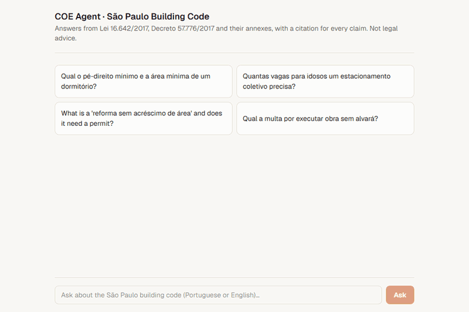
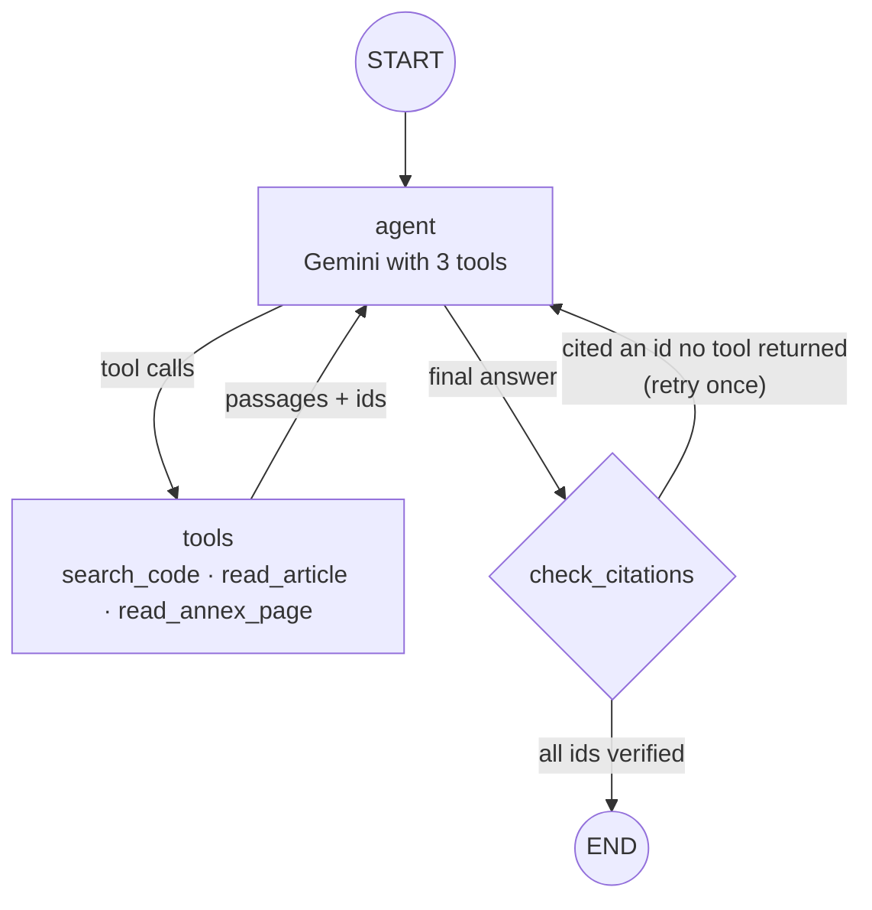
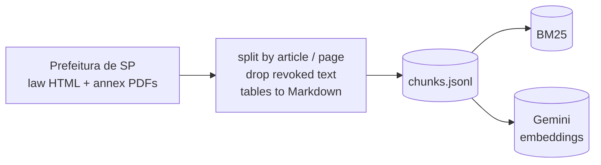
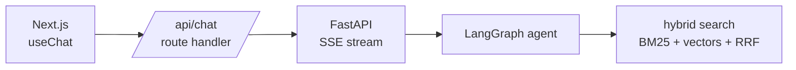

# COE Agent · São Paulo Building Code assistant

An AI agent that answers questions about the **São Paulo Building Code** (*Código de Obras e Edificações*, COE) and **cites the exact article or annex page behind every claim**.

It is a small, complete RAG project built with **LangGraph**, **LangChain** and **Gemini**, with a **Next.js + Vercel AI SDK** chat front end.



## Why

Architects and engineers in São Paulo check the COE all the time: minimum ceiling heights, parking for elderly drivers, what counts as a renovation, fines. The rules are spread across a law, the decree that regulates it, and PDF annexes with tables, so finding one number can take a while. A chatbot that answers from memory is risky here, because it can quote another city's code or an old version.

This agent only answers from the official consolidated text. A guardrail node in the graph rejects any answer that cites a passage the agent never retrieved.

## What it does

- **Hybrid retrieval**: BM25 for exact legal terms (*pé-direito*, *recuo*) and Gemini embeddings for meaning, fused with Reciprocal Rank Fusion.
- **Structure-aware chunks**: laws are split **by article** (`art. 31`), annexes **by PDF page** (`p. 9`), so every chunk is a real citation. Text marked as revoked in the consolidated version is dropped, and PDF tables are also extracted as Markdown so the model can read rows and columns.
- **Agent with 3 tools** (LangGraph): `search_code`, `read_article` (to follow cross-references such as "see art. 40") and `read_annex_page` (to read a whole table).
- **Citation check node**: every `[id]` in the answer must match a passage a tool returned. If one doesn't, the agent gets one chance to rewrite, and the front end drops the unverified draft (AI SDK `reset-step`).
- **Streaming UI**: the FastAPI server speaks the Vercel AI SDK UI message stream protocol, so `useChat` shows the tool calls live and turns citations into clickable links to the official source.
- Questions in **Portuguese or English**; answers come back in the language of the question.

## Architecture

**The LangGraph agent** (`backend/src/coe_agent/graph.py`):



**Ingestion** (`coe-ingest`, run once):



**Request path**:



| Layer | Stack |
| --- | --- |
| Agent | LangGraph `StateGraph` (custom nodes, conditional edges, typed state with reducers) |
| LLM / embeddings | Gemini via `langchain-google-genai` (`init_chat_model`, so any LangChain provider can be swapped in) |
| Retrieval | `rank-bm25` + cosine search over Gemini embeddings, Reciprocal Rank Fusion |
| Parsing | BeautifulSoup (consolidated law HTML), PyMuPDF (annex PDFs and tables) |
| API | FastAPI streaming the Vercel AI SDK UI message stream protocol |
| Front end | Next.js 16, React 19, AI SDK `useChat`, Tailwind |
| Tests | pytest with a scripted fake LLM (no API key needed) |

## Quickstart

You need Python 3.11+, [uv](https://docs.astral.sh/uv/), Node 20+ and a free Gemini API key from [Google AI Studio](https://aistudio.google.com/apikey).

```bash
git clone https://github.com/JuliaNazka/sp-building-code-agent.git
cd sp-building-code-agent
cp .env.example .env          # paste your GOOGLE_API_KEY
```

**1. Build the index** (downloads the official sources, chunks them, embeds them):

```bash
cd backend
uv sync
uv run coe-ingest
```

**2. Ask from the terminal:**

```bash
uv run coe-ask --trace "Qual o pé-direito mínimo e a área mínima de um dormitório?"
```

**3. Run the chat UI:**

```bash
uv run coe-serve              # API on http://127.0.0.1:8000
```

```bash
cd frontend
npm install
npm run dev                   # http://localhost:3000
```

**Tests** (no API key needed):

```bash
cd backend
uv run --group dev pytest
```

## Example

A question in English about a table that only exists in Portuguese, in a PDF annex:

```text
$ uv run coe-ask --trace "How many parking spaces for elderly drivers does a public parking lot with 200 spaces need?"

-> search_code({'query': 'vagas idoso estacionamento público quantidade', 'scope': 'all'})
-> search_code({'scope': 'all', 'query': 'vagas especiais idosos coletivo mais de 10 vagas'})
-> search_code({'query': 'vagas para idosos coletivo com mais de 10 vagas percentual', 'scope': 'all'})

A public parking lot (classified as *coletivo*, meaning intended for non-residential activity)
with more than 10 spaces requires **3%** of its total automobile spaces to be reserved for
elderly drivers (*vagas para idosos*) [L16642-anexos:p5].

For 200 spaces, this equals **6 spaces**.

[L16642-anexos:p5] Anexos I, II e III da Lei nº 16.642/2017, p. 5 (Anexo I)
    https://legislacao.prefeitura.sp.gov.br/leis/lei-16642-de-09-de-maio-de-2017/anexo/.../Anexos...pdf#page=5
```

The agent translated the question into Portuguese legal terms, found the parking table (the row *Coletivo com mais de 10 vagas: 3%*) and did the arithmetic. The citation links to the exact PDF page.

## Project layout

```
backend/src/coe_agent/
  config.py      sources, models, paths
  ingest.py      download -> article/page chunks -> embeddings
  retrieval.py   BM25 + vectors + RRF
  tools.py       the agent's 3 tools (content + artifact)
  graph.py       LangGraph: agent -> tools -> check_citations
  server.py      FastAPI, AI SDK UI message stream
  cli.py         coe-ask
backend/tests/   offline tests with a fake LLM
frontend/app/    Next.js chat (useChat) + /api/chat proxy
data/chunks.jsonl  the processed corpus (292 chunks)
```

## Limitations

- It covers the COE only. Zoning (LPUOS), fire safety (Corpo de Bombeiros ITs) and accessibility (NBR 9050) are out of scope, and the agent says so when a question depends on them.
- Some annex tables have merged cells. The Markdown extraction helps, but the model can still misread a row, so check the cited page.
- The citation check proves that every cited passage was **retrieved**, not that it **supports** the sentence. In one test the agent correctly said that a *reparo* needs no permit, but cited the definition in art. 3 instead of art. 13, I, which is where the exemption is. A claim-level check (an LLM judge or an entailment model per sentence) is the natural next node in the graph.
- No evaluation set yet. A next step is a small question/answer set scored for retrieval hit rate and citation accuracy.
- The default model is `gemini-3.5-flash-lite` because the free tier of the larger Flash model allows only about 20 requests a day, and one question takes 3 to 7 calls. Set `COE_CHAT_MODEL` for a stronger model.
- Not legal advice.

## Data and license

The sources are the official consolidated texts published by the [Prefeitura de São Paulo](https://legislacao.prefeitura.sp.gov.br/leis/lei-16642-de-09-de-maio-de-2017). Under Brazilian copyright law (Lei 9.610/1998, art. 8, IV) the texts of laws and decrees are not protected by copyright. Raw files are downloaded at ingest time and are not stored in this repository.

Code: [MIT](LICENSE) © Júlia Nazka
